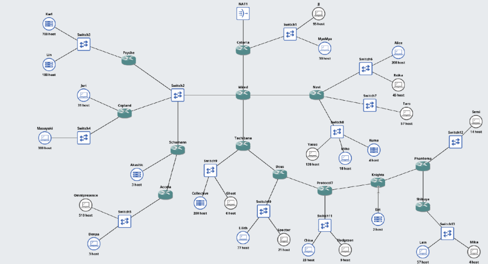
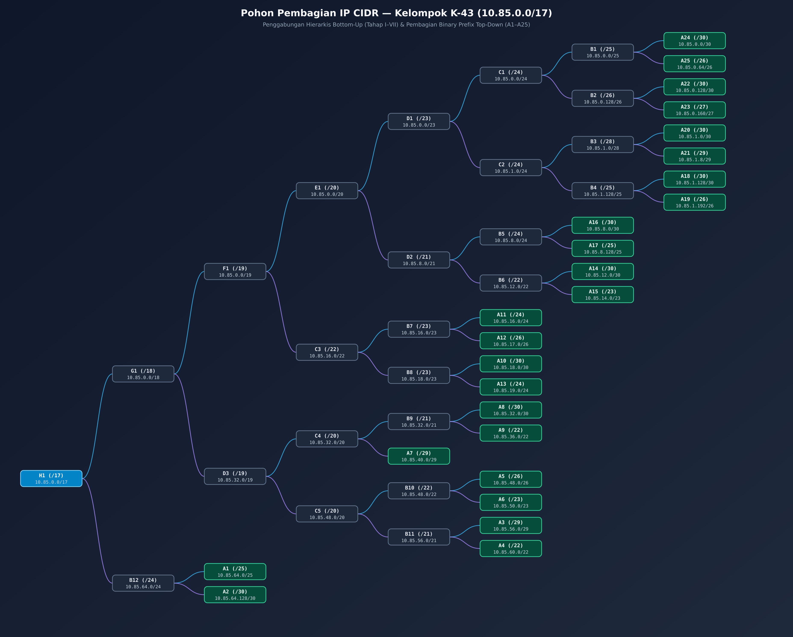

# Laporan Resmi Praktikum Komunikasi Data & Jaringan Komputer 2026 - Modul 4
> **Serial Experiments Lain — Layer:04: The Wired Expansion**  
> **Kelompok:** K-43  
> **Prefix IP:** `10.85.x.x`  
> **Metode Classless:** VLSM (Cisco Packet Tracer) & CIDR / Supernetting (GNS3)

---

## Anggota Kelompok

| NAMA | NRP |
| :--- | :--- |
| **I Ketut Weda Adikusuma** | 5027251061 |
| **D'qhaizhar Ari Dhiaulhaq** | 5027251083 |

---

## Glosarium Topologi & Struktur Arsitektur

Arsitektur **The Wired Expansion** merepresentasikan jaringan berskala besar yang terdiri atas **13 Router**, **13 Switch Layer-2**, **25 Entitas Client/Server**, serta **1 Gerbang Eksternal** (`Cloud0` pada Cisco Packet Tracer / `NAT1` pada GNS3). Hanya router **`Cyberia`** yang terhubung langsung ke jaringan eksternal; seluruh lalu lintas internal mengalir melalui hub **`Wired`** yang bercabang menuju tiga zona utama:
1. **Zona Segmen Bersama (`Switch2`)**: Menghubungkan `Wired` dengan tiga router cabang sekaligus, yaitu **`Psyche`** (`Karl`, `Lin`), **`Copland`** (`Juri`, `Masayuki`), dan **`Schumann`** (`Akashic`) yang meneruskan jalur ke **`Accela`** (`Omnipresence`, `Denpa`).
2. **Zona Distribusi Timur (`Navi`)**: Menghubungkan tiga segmen LAN terpisah menuju `Alice` & `Reika` (`Switch6`), `Taro` (`Switch7`), serta `Yasuo`, `Miho`, & `Kuma` (`Switch8`).
3. **Zona Rantai Lapisan Dalam (`Tachibana` → `Shibuya`)**: Rantai enam router berurutan mulai dari **`Tachibana`** (`Collective`, `Ghost`), **`Deus`** (`Lilith`, `Specter`), **`Protocol7`** (`Chisa`, `Hodgeson`), **`Knights`** (`Eiri`), **`Phantoma`** (`Semi`), hingga lapisan terdalam **`Shibuya`** (`Lain`, `Mika`).


*Gambar 0.1: Topologi jaringan Layer:04 — The Wired Expansion beserta kebutuhan jumlah host pada setiap entitas.*

### Struktur Berkas Repository

| Berkas / Direktori | Keterangan |
| :--- | :--- |
| `Subnetting Modul 4 Komdat Jarkom 2026.xlsx` | Workbook perhitungan lengkap 4 lembar kerja (`Rute`, `Pembagian IP - VLSM`, `Penggabungan - CIDR`, `Pembagian IP - CIDR`) |
| `VLSM.pkt` | Implementasi topologi dan static routing metode **VLSM** pada Cisco Packet Tracer |
| `K-43-MODUL-4.gns3project` | Implementasi topologi dan hierarchical routing metode **CIDR** pada GNS3 (`ardhptr21/alpinet:latest`) |
| `Images/pohon-cidr.png` | Diagram pohon biner penggabungan bottom-up dan pembagian top-down alamat IP CIDR (`10.85.0.0/17`) |
| `scripts/*.sh`, `scripts/*.py` | Skrip inisialisasi persisten `/root/init.sh` per-node GNS3 beserta skrip otomasi dan pengujian konektivitas |
| `scripts/cpt/*.txt` | Skrip konfigurasi CLI Cisco IOS per-router serta gabungan (`script-gabungan.txt`) untuk Cisco Packet Tracer |

---

## Step 1: Analisis Rute & Perhitungan Kebutuhan Subnet (Sheet `Rute`)

### Soal & Ketentuan
Seluruh segmen jaringan pada topologi wajib diidentifikasi rutenya satu per satu (`A1` s.d. `A25`). Jumlah kebutuhan alamat IP pada setiap segmen dihitung dari akumulasi jumlah host pada seluruh entitas di segmen tersebut ditambah jumlah antarmuka (*interface*) router yang terhubung langsung ke segmen tersebut, kemudian dipetakan ke panjang prefix (*netmask*) classless paling efisien.

### Metodologi Perhitungan Sheet `Rute`
Untuk setiap segmen $A_i$, kebutuhan alamat IP dan panjang prefix ditentukan melalui tiga langkah matematis:
1. **Hitung Total IP Dibutuhkan**:
   $$\text{Jumlah IP} = \left(\sum \text{Host pada Segmen}\right) + \text{Jumlah Port Router pada Segmen}$$
2. **Tentukan Jumlah Bit Host ($h$) Minimum**:
   Cari bilangan bulat terkecil $h$ sedemikian sehingga kapasitas usable memenuhi:
   $$2^h - 2 \ge \text{Jumlah IP}$$
   Pengurangan $2$ merepresentasikan dua alamat yang tidak boleh diberikan ke perangkat, yaitu **Network ID** (seluruh bit host bernilai `0`) dan **Broadcast Address** (seluruh bit host bernilai `1`).
3. **Hitung Panjang Prefix ($p$)**:
   $$p = 32 - h$$

**Contoh Penerapan pada Empat Pola Segmen di Topologi:**
- **Segmen LAN Multi-Host (`A4`: `Psyche > Switch3 > Karl, Lin`)**: Memiliki $700 + 180 = 880\text{ host}$ ditambah $1\text{ port}$ router `Psyche` = **$881\text{ IP}$**. Karena $2^9 - 2 = 510 < 881$ dan $2^{10} - 2 = 1022 \ge 881$, diperoleh $h = 10 \implies p = 32 - 10 =$ **`/22`** (`255.255.252.0`).
- **Segmen Transit Multi-Router (`A3`: `Wired > Switch2 > Psyche, Copland, Schumann`)**: Tidak memiliki PC klien ($0\text{ host}$), namun menghubungkan $4\text{ port}$ router pada satu broadcast domain `Switch2` = **$4\text{ IP}$**. Karena $2^2 - 2 = 2 < 4$ dan $2^3 - 2 = 6 \ge 4$, diperoleh $h = 3 \implies p = 32 - 3 =$ **`/29`** (`255.255.255.248`).
- **Segmen Router-ke-Node Tanpa Switch (`A21`: `Knights > Eiri`)**: Memiliki $2\text{ host}$ pada `Eiri` ditambah $1\text{ port}$ router `Knights` = **$3\text{ IP}$**. Karena `/30` hanya menyediakan $2\text{ usable IP}$, dipilih $h = 3 \implies$ **`/29`** ($6\text{ usable IP}$).
- **Segmen Point-to-Point Antar-Router (`A2`, `A8`, `A10`, `A14`, `A16`, `A18`, `A20`, `A22`, `A24`)**: Masing-masing menghubungkan tepat $2\text{ port}$ router = **$2\text{ IP}$**, sehingga $2^2 - 2 = 2 \ge 2 \implies$ **`/30`** (`255.255.255.252`) tanpa ada satupun usable IP yang terbuang.

### Tabel Hasil Sheet 1 (`Rute`)

| Nama Subnet | Rute | Rincian (Host + Router) | Jumlah IP | Netmask (Prefix) | Ukuran Blok ($2^h$) | Usable Maks ($2^h - 2$) |
| :---: | :--- | :---: | :---: | :---: | :---: | :---: |
| **A1** | `Cyberia > Switch1 > JJ, MyuMyu` | $(95 + 30) + 1$ | **126** | `/25` | 128 | 126 |
| **A2** | `Cyberia > Wired` | $0 + 2$ | **2** | `/30` | 4 | 2 |
| **A3** | `Wired > Switch2 > Psyche, Copland, Schumann` | $0 + 4$ | **4** | `/29` | 8 | 6 |
| **A4** | `Psyche > Switch3 > Karl, Lin` | $(700 + 180) + 1$ | **881** | `/22` | 1024 | 1022 |
| **A5** | `Copland > Juri` | $31 + 1$ | **32** | `/26` | 64 | 62 |
| **A6** | `Copland > Switch4 > Masayuki` | $300 + 1$ | **301** | `/23` | 512 | 510 |
| **A7** | `Schumann > Akashic` | $3 + 1$ | **4** | `/29` | 8 | 6 |
| **A8** | `Schumann > Accela` | $0 + 2$ | **2** | `/30` | 4 | 2 |
| **A9** | `Accela > Switch5 > Omnipresence, Denpa` | $(510 + 3) + 1$ | **514** | `/22` | 1024 | 1022 |
| **A10** | `Wired > Navi` | $0 + 2$ | **2** | `/30` | 4 | 2 |
| **A11** | `Navi > Switch6 > Alice, Reika` | $(208 + 45) + 1$ | **254** | `/24` | 256 | 254 |
| **A12** | `Navi > Switch7 > Taro` | $57 + 1$ | **58** | `/26` | 64 | 62 |
| **A13** | `Navi > Switch8 > Yasuo, Miho, Kuma` | $(120 + 18 + 4) + 1$ | **143** | `/24` | 256 | 254 |
| **A14** | `Wired > Tachibana` | $0 + 2$ | **2** | `/30` | 4 | 2 |
| **A15** | `Tachibana > Switch9 > Collective, Ghost` | $(260 + 6) + 1$ | **267** | `/23` | 512 | 510 |
| **A16** | `Tachibana > Deus` | $0 + 2$ | **2** | `/30` | 4 | 2 |
| **A17** | `Deus > Switch10 > Lilith, Specter` | $(77 + 21) + 1$ | **99** | `/25` | 128 | 126 |
| **A18** | `Deus > Protocol7` | $0 + 2$ | **2** | `/30` | 4 | 2 |
| **A19** | `Protocol7 > Switch11 > Chisa, Hodgeson` | $(23 + 9) + 1$ | **33** | `/26` | 64 | 62 |
| **A20** | `Protocol7 > Knights` | $0 + 2$ | **2** | `/30` | 4 | 2 |
| **A21** | `Knights > Eiri` | $2 + 1$ | **3** | `/29` | 8 | 6 |
| **A22** | `Knights > Phantoma` | $0 + 2$ | **2** | `/30` | 4 | 2 |
| **A23** | `Phantoma > Switch12 > Semi` | $14 + 1$ | **15** | `/27` | 32 | 30 |
| **A24** | `Phantoma > Shibuya` | $0 + 2$ | **2** | `/30` | 4 | 2 |
| **A25** | `Shibuya > Switch13 > Lain, Mika` | $(57 + 4) + 1$ | **62** | `/26` | 64 | 62 |
| **Total** | **Seluruh 25 Segmen** | $2775 + 39$ | **2814** | **`/19`** | **4188** | — |

**Penjelasan Baris Total (`/19`):**
Meskipun jumlah alamat murni yang diminta adalah $2.814\text{ IP}$, setiap subnet wajib menempati blok perpangkatan dua ($2^h$). Akumulasi seluruh ukuran blok dari `A1` hingga `A25` adalah $4.188\text{ alamat}$, yang melampaui kapasitas blok `/20` ($2^{12} = 4.096\text{ alamat}$). Oleh sebab itu, blok supernet tunggal terkecil yang mampu memuat ke-25 subnet VLSM secara utuh adalah **`/19`** ($2^{13} = 8.192\text{ alamat}$).

---

## Step 2: Metodologi Perhitungan & Penugasan IP VLSM (Sheet `Pembagian IP - VLSM`)

### Prosedur Penurunan Sheet `Pembagian IP - VLSM`
Metode **Variable Length Subnet Masking (VLSM)** mengalokasikan ruang alamat dari `10.85.0.0` dengan meminimalkan alamat terbuang melalui empat tahapan sistematis:

1. **Pengurutan Kapasitas Menurun (*Largest-Block First*)**:
   Urutkan ke-25 subnet dari ukuran blok terbesar ke terkecil (`/22` $\to$ `/23` $\to$ `/24` $\to$ `/25` $\to$ `/26` $\to$ `/27` $\to$ `/29` $\to$ `/30`). Pengurutan ini menjamin bahwa setiap subnet secara otomatis jatuh tepat di kelipatan ukuran bloknya tanpa meninggalkan celah kosong (*zero fragmentation*) di antara subnet.
2. **Perhitungan Network ID Berantai (*Block Increment*)**:
   Dimulai dari `10.85.0.0`:
   - Untuk prefix **$p < 24$** (`/22` dan `/23`), penambahan terjadi pada **oktet ke-3** sebesar $\Delta_3 = 2^{24 - p}$ (`/22` menambah $+4$ pada oktet ke-3; `/23` menambah $+2$ pada oktet ke-3).
   - Untuk prefix **$p \ge 24$** (`/24` s.d. `/30`), penambahan terjadi pada **oktet ke-4** sebesar $\Delta_4 = 2^{32 - p}$ (`/24` menambah $+1$ pada oktet ke-3; `/25` $+128$; `/26` $+64$; `/27` $+32$; `/29` $+8$; `/30` $+4$ pada oktet ke-4).
3. **Penentuan Broadcast Address & Range IP**:
   - $\text{Broadcast Address} = \text{Network ID subnet berikutnya} - 1$
   - $\text{Range Usable IP} = (\text{Network ID} + 1) \text{ sampai } (\text{Broadcast Address} - 1)$
4. **Konvensi Penugasan Alamat IP ke Perangkat (*IP Assigning*)**:
   - **Pada Segmen LAN (`Router > Switch > Host` atau `Router > Host`)**: Alamat usable pertama (`Network ID + 1`) selalu ditugaskan pada **antarmuka Router** sebagai *Default Gateway* segmen tersebut, sedangkan alamat usable berikutnya (`Network ID + 2`, `Network ID + 3`, dst.) ditugaskan ke **entitas Host** secara berurutan.
   - **Pada Segmen Transit Antar-Router (`/30` dan `/29` `Switch2`)**: Alamat usable pertama (`Network ID + 1`) ditugaskan ke **Router Upstream** (yang lebih dekat ke `Cyberia`), dan alamat usable berikutnya (`Network ID + 2`, dst.) ditugaskan ke **Router Downstream**.

### Tabel Urutan Eksekusi Alokasi VLSM (Terbesar ke Terkecil)

| Urutan | Subnet | Kebutuhan | Prefix & Netmask | Increment Blok | Network ID | Broadcast | Range Usable IP |
| :---: | :---: | :---: | :--- | :---: | :--- | :--- | :--- |
| 1 | **A4** | 881 | `/22` (`255.255.252.0`) | Oktet-3 `+4` | `10.85.0.0` | `10.85.3.255` | `10.85.0.1 - 10.85.3.254` |
| 2 | **A9** | 514 | `/22` (`255.255.252.0`) | Oktet-3 `+4` | `10.85.4.0` | `10.85.7.255` | `10.85.4.1 - 10.85.7.254` |
| 3 | **A6** | 301 | `/23` (`255.255.254.0`) | Oktet-3 `+2` | `10.85.8.0` | `10.85.9.255` | `10.85.8.1 - 10.85.9.254` |
| 4 | **A15** | 267 | `/23` (`255.255.254.0`) | Oktet-3 `+2` | `10.85.10.0` | `10.85.11.255` | `10.85.10.1 - 10.85.11.254` |
| 5 | **A11** | 254 | `/24` (`255.255.255.0`) | Oktet-3 `+1` | `10.85.12.0` | `10.85.12.255` | `10.85.12.1 - 10.85.12.254` |
| 6 | **A13** | 143 | `/24` (`255.255.255.0`) | Oktet-3 `+1` | `10.85.13.0` | `10.85.13.255` | `10.85.13.1 - 10.85.13.254` |
| 7 | **A1** | 126 | `/25` (`255.255.255.128`) | Oktet-4 `+128` | `10.85.14.0` | `10.85.14.127` | `10.85.14.1 - 10.85.14.126` |
| 8 | **A17** | 99 | `/25` (`255.255.255.128`) | Oktet-4 `+128` | `10.85.14.128` | `10.85.14.255` | `10.85.14.129 - 10.85.14.254` |
| 9 | **A25** | 62 | `/26` (`255.255.255.192`) | Oktet-4 `+64` | `10.85.15.0` | `10.85.15.63` | `10.85.15.1 - 10.85.15.62` |
| 10 | **A12** | 58 | `/26` (`255.255.255.192`) | Oktet-4 `+64` | `10.85.15.64` | `10.85.15.127` | `10.85.15.65 - 10.85.15.126` |
| 11 | **A19** | 33 | `/26` (`255.255.255.192`) | Oktet-4 `+64` | `10.85.15.128` | `10.85.15.191` | `10.85.15.129 - 10.85.15.190` |
| 12 | **A5** | 32 | `/26` (`255.255.255.192`) | Oktet-4 `+64` | `10.85.15.192` | `10.85.15.255` | `10.85.15.193 - 10.85.15.254` |
| 13 | **A23** | 15 | `/27` (`255.255.255.224`) | Oktet-4 `+32` | `10.85.16.0` | `10.85.16.31` | `10.85.16.1 - 10.85.16.30` |
| 14 | **A3** | 4 | `/29` (`255.255.255.248`) | Oktet-4 `+8` | `10.85.16.32` | `10.85.16.39` | `10.85.16.33 - 10.85.16.38` |
| 15 | **A7** | 4 | `/29` (`255.255.255.248`) | Oktet-4 `+8` | `10.85.16.40` | `10.85.16.47` | `10.85.16.41 - 10.85.16.46` |
| 16 | **A21** | 3 | `/29` (`255.255.255.248`) | Oktet-4 `+8` | `10.85.16.48` | `10.85.16.55` | `10.85.16.49 - 10.85.16.54` |
| 17 | **A2** | 2 | `/30` (`255.255.255.252`) | Oktet-4 `+4` | `10.85.16.56` | `10.85.16.59` | `10.85.16.57 - 10.85.16.58` |
| 18 | **A8** | 2 | `/30` (`255.255.255.252`) | Oktet-4 `+4` | `10.85.16.60` | `10.85.16.63` | `10.85.16.61 - 10.85.16.62` |
| 19 | **A10** | 2 | `/30` (`255.255.255.252`) | Oktet-4 `+4` | `10.85.16.64` | `10.85.16.67` | `10.85.16.65 - 10.85.16.66` |
| 20 | **A14** | 2 | `/30` (`255.255.255.252`) | Oktet-4 `+4` | `10.85.16.68` | `10.85.16.71` | `10.85.16.69 - 10.85.16.70` |
| 21 | **A16** | 2 | `/30` (`255.255.255.252`) | Oktet-4 `+4` | `10.85.16.72` | `10.85.16.75` | `10.85.16.73 - 10.85.16.74` |
| 22 | **A18** | 2 | `/30` (`255.255.255.252`) | Oktet-4 `+4` | `10.85.16.76` | `10.85.16.79` | `10.85.16.77 - 10.85.16.78` |
| 23 | **A20** | 2 | `/30` (`255.255.255.252`) | Oktet-4 `+4` | `10.85.16.80` | `10.85.16.83` | `10.85.16.81 - 10.85.16.82` |
| 24 | **A22** | 2 | `/30` (`255.255.255.252`) | Oktet-4 `+4` | `10.85.16.84` | `10.85.16.87` | `10.85.16.85 - 10.85.16.86` |
| 25 | **A24** | 2 | `/30` (`255.255.255.252`) | Oktet-4 `+4` | `10.85.16.88` | `10.85.16.91` | `10.85.16.89 - 10.85.16.90` |

### Tabel Hasil Sheet 2 (`Pembagian IP - VLSM` Urut `A1` – `A25`)

| Subnet | Network ID | Netmask | Broadcast | Range IP |
| :---: | :--- | :--- | :--- | :--- |
| **A1** | `10.85.14.0` | `255.255.255.128` | `10.85.14.127` | `10.85.14.1 - 10.85.14.126` |
| **A2** | `10.85.16.56` | `255.255.255.252` | `10.85.16.59` | `10.85.16.57 - 10.85.16.58` |
| **A3** | `10.85.16.32` | `255.255.255.248` | `10.85.16.39` | `10.85.16.33 - 10.85.16.38` |
| **A4** | `10.85.0.0` | `255.255.252.0` | `10.85.3.255` | `10.85.0.1 - 10.85.3.254` |
| **A5** | `10.85.15.192` | `255.255.255.192` | `10.85.15.255` | `10.85.15.193 - 10.85.15.254` |
| **A6** | `10.85.8.0` | `255.255.254.0` | `10.85.9.255` | `10.85.8.1 - 10.85.9.254` |
| **A7** | `10.85.16.40` | `255.255.255.248` | `10.85.16.47` | `10.85.16.41 - 10.85.16.46` |
| **A8** | `10.85.16.60` | `255.255.255.252` | `10.85.16.63` | `10.85.16.61 - 10.85.16.62` |
| **A9** | `10.85.4.0` | `255.255.252.0` | `10.85.7.255` | `10.85.4.1 - 10.85.7.254` |
| **A10** | `10.85.16.64` | `255.255.255.252` | `10.85.16.67` | `10.85.16.65 - 10.85.16.66` |
| **A11** | `10.85.12.0` | `255.255.255.0` | `10.85.12.255` | `10.85.12.1 - 10.85.12.254` |
| **A12** | `10.85.15.64` | `255.255.255.192` | `10.85.15.127` | `10.85.15.65 - 10.85.15.126` |
| **A13** | `10.85.13.0` | `255.255.255.0` | `10.85.13.255` | `10.85.13.1 - 10.85.13.254` |
| **A14** | `10.85.16.68` | `255.255.255.252` | `10.85.16.71` | `10.85.16.69 - 10.85.16.70` |
| **A15** | `10.85.10.0` | `255.255.254.0` | `10.85.11.255` | `10.85.10.1 - 10.85.11.254` |
| **A16** | `10.85.16.72` | `255.255.255.252` | `10.85.16.75` | `10.85.16.73 - 10.85.16.74` |
| **A17** | `10.85.14.128` | `255.255.255.128` | `10.85.14.255` | `10.85.14.129 - 10.85.14.254` |
| **A18** | `10.85.16.76` | `255.255.255.252` | `10.85.16.79` | `10.85.16.77 - 10.85.16.78` |
| **A19** | `10.85.15.128` | `255.255.255.192` | `10.85.15.191` | `10.85.15.129 - 10.85.15.190` |
| **A20** | `10.85.16.80` | `255.255.255.252` | `10.85.16.83` | `10.85.16.81 - 10.85.16.82` |
| **A21** | `10.85.16.48` | `255.255.255.248` | `10.85.16.55` | `10.85.16.49 - 10.85.16.54` |
| **A22** | `10.85.16.84` | `255.255.255.252` | `10.85.16.87` | `10.85.16.85 - 10.85.16.86` |
| **A23** | `10.85.16.0` | `255.255.255.224` | `10.85.16.31` | `10.85.16.1 - 10.85.16.30` |
| **A24** | `10.85.16.88` | `255.255.255.252` | `10.85.16.91` | `10.85.16.89 - 10.85.16.90` |
| **A25** | `10.85.15.0` | `255.255.255.192` | `10.85.15.63` | `10.85.15.1 - 10.85.15.62` |

---

## Step 3: Implementasi & Summarized Static Routing VLSM pada Cisco Packet Tracer (`VLSM.pkt`)

### Strategi Penyusunan Tabel Routing dari Sheet VLSM
Agar tabel routing pada Cisco Packet Tracer seefisien mungkin tanpa menggunakan dynamic routing protocol, aturan static routing diturunkan langsung dari posisi tiap router pada pohon topologi dan keselarasan blok biner pada Sheet 2:

1. **Router Leaf / Ujung (`Psyche`, `Copland`, `Accela`, `Navi`, `Shibuya`)**:
   Tidak memiliki router lain di bawahnya. Seluruh paket menuju subnet luar cukup diarahkan menggunakan **satu baris Default Route** (`0.0.0.0 0.0.0.0 <Next-Hop-Upstream>`).
2. **Router Pusat (`Cyberia`)**:
   Seluruh 23 subnet internal lainnya berada di bawah `Wired`. Alih-alih menulis 23 baris rute, `Cyberia` cukup memasang **satu baris rute supernet** `ip route 10.85.0.0 255.255.224.0 10.85.16.58` (`/19`). Karena `Cyberia` terhubung langsung ke `A1` (`10.85.14.0/25`) dan `A2` (`10.85.16.56/30`), mekanisme **Longest Prefix Match** pada Cisco IOS otomatis memprioritaskan rute *Connected* `/25` dan `/30` untuk trafik lokal, sementara seluruh paket lain dalam rentang `10.85.0.0/19` diteruskan ke `Wired`.
3. **Router Hub & Rantai Transit (`Wired`, `Schumann`, `Tachibana`, `Deus`, `Protocol7`, `Knights`, `Phantoma`)**:
   - Ke arah atas (menuju `Cyberia` dan cabang lain), masing-masing cukup memasang **satu Default Route** `0.0.0.0 0.0.0.0`.
   - Ke arah bawah (*downstream*), subnet-subnet yang bersebelahan pada batas biner diringkas (*route summarization*):
     - Pada **`Wired`** menuju **`Navi`** (`10.85.16.66`): subnet `A11` (`10.85.12.0/24`) dan `A13` (`10.85.13.0/24`) memiliki 23 bit pertama identik (`00001100` dan `00001101` pada oktet ke-3), sehingga diringkas menjadi satu entri **`10.85.12.0 255.255.254.0`** (`/23`), ditambah `A12` (`10.85.15.64/26`).
     - Pada **`Wired`** & rantai **`Tachibana`**: link P2P `A16` (`10.85.16.72/30`) + `A18` (`10.85.16.76/30`) diringkas menjadi **`10.85.16.72/29`**, dan `A20` (`10.85.16.80/30`) + `A22` (`10.85.16.84/30`) diringkas menjadi **`10.85.16.80/29`**. Adapun subnet LAN sepanjang rantai `Tachibana` (`A15` `.10.0/23`, `A17` `.14.128/25`, `A25` `.15.0/26`, `A19` `.15.128/26`, `A23` `.16.0/27`, `A21` `.16.48/29`) tetap ditulis spesifik agar tidak menabrak subnet milik cabang `Copland` (`.15.192/26`), `Navi` (`.15.64/26`), maupun `Schumann` (`.16.40/29`) yang berada di blok berdekatan akibat pengurutan ukuran VLSM.

### Konfigurasi Perangkat Keras & Cisco IOS (`VLSM.pkt`)
Seluruh 13 router menggunakan seri **Cisco 2811** dengan tambahan modul **`NM-1FE-TX`** (`FastEthernet1/0`) agar setiap router berderajat 3 memiliki tiga port Layer-3 murni (`Fa0/0`, `Fa0/1`, `Fa1/0`). Khusus router berderajat 4 (`Wired` dan `Navi`), port ke-4 memanfaatkan modul **`HWIC-4ESW`** (`FastEthernet0/3/0`) yang diikat ke SVI `interface Vlan1`. Pemasangan kabel mengikuti aturan MDI/MDI-X perangkat keras secara ketat (*Copper Cross-Over* untuk koneksi Router-ke-Router, Router-ke-PC/Server, dan Switchport-ke-Switchport; *Copper Straight-Through* untuk koneksi Router-L3 ke Switchport atau `Cloud0`).

**Contoh Konfigurasi CLI Router Pusat `Cyberia` & Hub `Wired` (`scripts/cpt/`):**
```ios
! === ROUTER CYBERIA ===
enable
configure terminal
hostname Cyberia
interface FastEthernet0/0
 ip address 10.85.16.57 255.255.255.252
 no shutdown
 exit
interface FastEthernet0/1
 ip address 10.85.14.1 255.255.255.128
 no shutdown
 exit
interface FastEthernet1/0
 no ip address
 no shutdown
 exit
ip route 10.85.0.0 255.255.224.0 10.85.16.58
end
write memory

! === ROUTER WIRED ===
enable
configure terminal
hostname Wired
interface FastEthernet0/0
 ip address 10.85.16.58 255.255.255.252
 no shutdown
 exit
interface FastEthernet0/1
 ip address 10.85.16.69 255.255.255.252
 no shutdown
 exit
interface FastEthernet1/0
 ip address 10.85.16.33 255.255.255.248
 no shutdown
 exit
interface FastEthernet0/3/0
 switchport mode access
 no shutdown
 exit
interface Vlan1
 ip address 10.85.16.65 255.255.255.252
 no shutdown
 exit
ip route 0.0.0.0 0.0.0.0 10.85.16.57
ip route 10.85.0.0 255.255.252.0 10.85.16.34
ip route 10.85.4.0 255.255.252.0 10.85.16.36
ip route 10.85.8.0 255.255.254.0 10.85.16.35
ip route 10.85.15.192 255.255.255.192 10.85.16.35
ip route 10.85.16.40 255.255.255.248 10.85.16.36
ip route 10.85.16.60 255.255.255.252 10.85.16.36
ip route 10.85.12.0 255.255.254.0 10.85.16.66
ip route 10.85.15.64 255.255.255.192 10.85.16.66
ip route 10.85.10.0 255.255.254.0 10.85.16.70
ip route 10.85.14.128 255.255.255.128 10.85.16.70
ip route 10.85.15.0 255.255.255.192 10.85.16.70
ip route 10.85.15.128 255.255.255.192 10.85.16.70
ip route 10.85.16.0 255.255.255.224 10.85.16.70
ip route 10.85.16.48 255.255.255.248 10.85.16.70
ip route 10.85.16.72 255.255.255.248 10.85.16.70
ip route 10.85.16.80 255.255.255.248 10.85.16.70
ip route 10.85.16.88 255.255.255.252 10.85.16.70
end
write memory
```

### Tabel Pemetaan Lengkap Router & Host pada Cisco Packet Tracer (VLSM)

| Router | Interface & Alamat IP | Ringkasan Static Route (`ip route`) |
| :--- | :--- | :--- |
| **Cyberia** | `Fa0/0`: `10.85.16.57/30` (`A2` Wired)<br>`Fa0/1`: `10.85.14.1/25` (`A1` Switch1)<br>`Fa1/0`: `Cloud0` (`up`) | `10.85.0.0/19 via 10.85.16.58` |
| **Wired** | `Fa0/0`: `10.85.16.58/30` (`A2` Cyberia)<br>`Fa0/1`: `10.85.16.69/30` (`A14` Tachibana)<br>`Fa1/0`: `10.85.16.33/29` (`A3` Switch2)<br>`Vlan1 (Fa0/3/0)`: `10.85.16.65/30` (`A10` Navi) | `0.0.0.0/0 via 10.85.16.57`<br>Ke Psyche (`.34`): `10.85.0.0/22`<br>Ke Copland (`.35`): `10.85.8.0/23`, `10.85.15.192/26`<br>Ke Schumann (`.36`): `10.85.4.0/22`, `10.85.16.40/29`, `10.85.16.60/30`<br>Ke Navi (`.66`): `10.85.12.0/23` (`A11+A13`), `10.85.15.64/26`<br>Ke Tachibana (`.70`): `10.85.10.0/23`, `10.85.14.128/25`, `10.85.15.0/26`, `10.85.15.128/26`, `10.85.16.0/27`, `10.85.16.48/29`, `10.85.16.72/29`, `10.85.16.80/29`, `10.85.16.88/30` |
| **Psyche** | `Fa0/0`: `10.85.16.34/29` (`A3`)<br>`Fa0/1`: `10.85.0.1/22` (`A4` Switch3) | `0.0.0.0/0 via 10.85.16.33` |
| **Copland** | `Fa0/0`: `10.85.16.35/29` (`A3`)<br>`Fa0/1`: `10.85.8.1/23` (`A6` Switch4)<br>`Fa1/0`: `10.85.15.193/26` (`A5` Juri) | `0.0.0.0/0 via 10.85.16.33` |
| **Schumann** | `Fa0/0`: `10.85.16.36/29` (`A3`)<br>`Fa0/1`: `10.85.16.61/30` (`A8` Accela)<br>`Fa1/0`: `10.85.16.41/29` (`A7` Akashic) | `0.0.0.0/0 via 10.85.16.33`<br>`10.85.4.0/22 via 10.85.16.62` |
| **Accela** | `Fa0/0`: `10.85.16.62/30` (`A8`)<br>`Fa0/1`: `10.85.4.1/22` (`A9` Switch5) | `0.0.0.0/0 via 10.85.16.61` |
| **Navi** | `Fa0/0`: `10.85.16.66/30` (`A10` Wired)<br>`Fa0/1`: `10.85.15.65/26` (`A12` Switch7)<br>`Fa1/0`: `10.85.12.1/24` (`A11` Switch6)<br>`Vlan1 (Fa0/3/0)`: `10.85.13.1/24` (`A13` Switch8) | `0.0.0.0/0 via 10.85.16.65` |
| **Tachibana** | `Fa0/0`: `10.85.16.70/30` (`A14`)<br>`Fa0/1`: `10.85.16.73/30` (`A16` Deus)<br>`Fa1/0`: `10.85.10.1/23` (`A15` Switch9) | `0.0.0.0/0 via 10.85.16.69`<br>Ke Deus (`.74`): `10.85.14.128/25`, `10.85.15.0/26`, `10.85.15.128/26`, `10.85.16.0/27`, `10.85.16.48/29`, `10.85.16.76/30`, `10.85.16.80/29`, `10.85.16.88/30` |
| **Deus** | `Fa0/0`: `10.85.16.74/30` (`A16`)<br>`Fa0/1`: `10.85.16.77/30` (`A18` Protocol7)<br>`Fa1/0`: `10.85.14.129/25` (`A17` Switch10) | `0.0.0.0/0 via 10.85.16.73`<br>Ke Protocol7 (`.78`): `10.85.15.0/26`, `10.85.15.128/26`, `10.85.16.0/27`, `10.85.16.48/29`, `10.85.16.80/29`, `10.85.16.88/30` |
| **Protocol7** | `Fa0/0`: `10.85.16.78/30` (`A18`)<br>`Fa0/1`: `10.85.16.81/30` (`A20` Knights)<br>`Fa1/0`: `10.85.15.129/26` (`A19` Switch11) | `0.0.0.0/0 via 10.85.16.77`<br>Ke Knights (`.82`): `10.85.15.0/26`, `10.85.16.0/27`, `10.85.16.48/29`, `10.85.16.84/30`, `10.85.16.88/30` |
| **Knights** | `Fa0/0`: `10.85.16.82/30` (`A20`)<br>`Fa0/1`: `10.85.16.85/30` (`A22` Phantoma)<br>`Fa1/0`: `10.85.16.49/29` (`A21` Eiri) | `0.0.0.0/0 via 10.85.16.81`<br>Ke Phantoma (`.86`): `10.85.15.0/26`, `10.85.16.0/27`, `10.85.16.88/30` |
| **Phantoma** | `Fa0/0`: `10.85.16.86/30` (`A22`)<br>`Fa0/1`: `10.85.16.89/30` (`A24` Shibuya)<br>`Fa1/0`: `10.85.16.1/27` (`A23` Switch12) | `0.0.0.0/0 via 10.85.16.85`<br>Ke Shibuya (`.90`): `10.85.15.0/26` |
| **Shibuya** | `Fa0/0`: `10.85.16.90/30` (`A24`)<br>`Fa0/1`: `10.85.15.1/26` (`A25` Switch13) | `0.0.0.0/0 via 10.85.16.89` |

| Subnet | Entitas Host | IP Address | Subnet Mask | Default Gateway |
| :---: | :--- | :--- | :--- | :--- |
| **A1** | `JJ` / `MyuMyu` | `10.85.14.2` / `10.85.14.3` | `255.255.255.128` (`/25`) | `10.85.14.1` |
| **A4** | `Karl` / `Lin` | `10.85.0.2` / `10.85.0.3` | `255.255.252.0` (`/22`) | `10.85.0.1` |
| **A5** | `Juri` | `10.85.15.194` | `255.255.255.192` (`/26`) | `10.85.15.193` |
| **A6** | `Masayuki` | `10.85.8.2` | `255.255.254.0` (`/23`) | `10.85.8.1` |
| **A7** | `Akashic` | `10.85.16.42` | `255.255.255.248` (`/29`) | `10.85.16.41` |
| **A9** | `Omnipresence` / `Denpa` | `10.85.4.2` / `10.85.4.3` | `255.255.252.0` (`/22`) | `10.85.4.1` |
| **A11** | `Alice` / `Reika` | `10.85.12.2` / `10.85.12.3` | `255.255.255.0` (`/24`) | `10.85.12.1` |
| **A12** | `Taro` | `10.85.15.66` | `255.255.255.192` (`/26`) | `10.85.15.65` |
| **A13** | `Yasuo` / `Miho` / `Kuma` | `10.85.13.2` / `.3` / `.4` | `255.255.255.0` (`/24`) | `10.85.13.1` |
| **A15** | `Collective` / `Ghost` | `10.85.10.2` / `10.85.10.3` | `255.255.254.0` (`/23`) | `10.85.10.1` |
| **A17** | `Lilith` / `Specter` | `10.85.14.130` / `10.85.14.131` | `255.255.255.128` (`/25`) | `10.85.14.129` |
| **A19** | `Chisa` / `Hodgeson` | `10.85.15.130` / `10.85.15.131` | `255.255.255.192` (`/26`) | `10.85.15.129` |
| **A21** | `Eiri` | `10.85.16.50` | `255.255.255.248` (`/29`) | `10.85.16.49` |
| **A23** | `Semi` | `10.85.16.2` | `255.255.255.224` (`/27`) | `10.85.16.1` |
| **A25** | `Lain` / `Mika` | `10.85.15.2` / `10.85.15.3` | `255.255.255.192` (`/26`) | `10.85.15.1` |

### Pengujian & Pembuktian VLSM pada Cisco Packet Tracer
Setelah topologi dibuka pada Cisco Packet Tracer (dan konvergensi Spanning-Tree dipercepat menggunakan tombol *Fast Forward Time* selama 30 detik agar SVI `Vlan1` pada `Wired` serta `Navi` beralih ke status *Forwarding*), pemeriksaan antarmuka, tabel routing, dan uji *end-to-end* dijalankan pada CLI router dan *Command Prompt* host:

```text
! Pemeriksaan ringkasan interface & rute supernet di CLI Router Cyberia & Wired
Cyberia# show ip interface brief
Cyberia# show ip route static

Wired# show ip interface brief
Wired# show ip route static

! Pengujian konektivitas lintas cabang dari Command Prompt Laptop Lain (10.85.15.2)
C:\> ipconfig
C:\> ping 10.85.14.2       (uji ke JJ - segmen Cyberia A1)
C:\> ping 10.85.0.2        (uji ke Karl - cabang Psyche A4)
C:\> ping 10.85.4.3        (uji ke Denpa - cabang Accela A9)
C:\> ping 10.85.13.4       (uji ke Kuma - cabang Navi Vlan1 A13)
C:\> tracert 10.85.0.2     (penelusuran 9 hop dari Shibuya menuju Karl)
```

**Penjelasan:**
Perintah `show ip route static` pada `Cyberia` membuktikan seluruh subnet di belakang `Wired` terjangkau hanya dengan satu rute `S 10.85.0.0/19 [1/0] via 10.85.16.58`, sedangkan `tracert 10.85.0.2` dari `Lain` membuktikan paket melintasi `10.85.15.1` (`Shibuya`) $\to$ `10.85.16.89` (`Phantoma`) $\to$ `10.85.16.85` (`Knights`) $\to$ `10.85.16.81` (`Protocol7`) $\to$ `10.85.16.77` (`Deus`) $\to$ `10.85.16.73` (`Tachibana`) $\to$ `10.85.16.69` (`Wired`) $\to$ `10.85.16.34` (`Psyche`) $\to$ `10.85.0.2` (`Karl`) tanpa adanya *routing loop*.


---

## Step 4: Metodologi Penggabungan & Pembagian IP CIDR / Supernetting (Sheet `Penggabungan - CIDR` & `Pembagian IP - CIDR`)

### Soal & Prinsip Dasar CIDR
Pada metode VLSM (Step 2), pengurutan blok murni berdasarkan ukuran populasi host menyebabkan subnet-subnet dalam satu cabang yang sama tersebar pada rentang alamat yang berjauhan (misalnya rantai `Tachibana`–`Shibuya` tersebar mulai dari `10.85.10.0/23` hingga `10.85.16.88/30`), sehingga router di hulu harus mendaftarkan banyak entri rute terpisah.

Metode **CIDR (*Classless Inter-Domain Routing*) / *Supernetting*** menyelesaikan masalah tersebut dengan mengelompokkan alamat IP berdasarkan **kedekatan topologi (*topological adjacency*)** melalui dua fase berurutan:
1. **Fase Penggabungan *Bottom-Up* (Sheet `Penggabungan - CIDR`)**: Menggabungkan pasangan subnet yang bernaung di bawah router yang sama mulai dari ujung terdalam (*leaf*) hingga menyatu di router pusat `Cyberia` (`H1`).
2. **Fase Pembagian *Top-Down* (Sheet `Pembagian IP - CIDR`)**: Memecah blok induk hasil penggabungan (`H1`) kembali ke bawah menelusuri pohon biner menuju masing-masing subnet `A1` s.d. `A25`.

---

### Fase 1: Aturan Penggabungan *Bottom-Up* (Sheet 3 — `Penggabungan - CIDR`)
Ketika dua blok jaringan anak dengan prefix $/p_1$ dan $/p_2$ digabungkan menjadi satu blok induk pada pohon biner IPv4, sebuah blok induk hanya dapat dibagi dua menjadi dua paruh berukuran identik. Agar kedua anak muat tanpa saling tumpang tindih, masing-masing paruh minimal harus sebesar blok anak yang paling lebar (yaitu prefix terkecil $\min(p_1, p_2)$), kemudian ditarik mundur $1\text{ bit}$ ke kiri untuk memayungi kedua paruh sekaligus:

$$p_{\text{induk}} = \min(p_1, p_2) - 1$$

Penelusuran dilakukan bertahap dari lapisan paling luar menuju akar topologi:
- **Tahap I (`B1` s.d. `B12`)**: Menggabungkan pasangan link transit router dan LAN lokal pada masing-masing router:
  - Contoh pada ujung rantai terdalam **`Shibuya`**: link `A24` (`/30`) digabung dengan LAN `A25` (`/26`) $\implies p_{B1} = \min(30, 26) - 1 = 26 - 1 =$ **`/25`** (`B1`).
  - Contoh pada **`Phantoma`**: link `A22` (`/30`) + LAN `A23` (`/27`) $\implies \min(30, 27) - 1 =$ **`/26`** (`B2`).
  - Contoh pada **`Navi`** (memiliki 4 segmen `A10`–`A13`): dipasangkan dua-dua terlebih dahulu, yaitu `A11` (`/24`) + `A12` (`/26`) $\to$ **`B7` (`/23`)** dan `A10` (`/30`) + `A13` (`/24`) $\to$ **`B8` (`/23`)**.
- **Tahap II s.d. Tahap VI (`C` $\to$ `G1`)**: Menggabungkan hasil Tahap I secara hierarkis mengikuti alur kabel antar-router menuju `Wired`:
  - Rantai bawah menyatu bertahap: `B1 (/25) + B2 (/26)` $\to$ **`C1` (`/24`)**; `B3 (/28) + B4 (/25)` $\to$ **`C2` (`/24`)**; `C1 + C2` $\to$ **`D1` (`/23`)**; `B5 (/24) + B6 (/22)` $\to$ **`D2` (`/21`)**; `D1 + D2` $\to$ **`E1` (`/20`)** (seluruh rantai `Tachibana`–`Shibuya`).
  - `E1 (/20)` digabung dengan cabang `Navi` **`C3` (`/22`)** menghasilkan **`F1` (`/19`)**.
  - Di sisi kiri (`Switch2`), cabang `Accela+Schumann` membentuk **`C4` (`/20`)** dan `Copland+Psyche` membentuk **`C5` (`/20`)**, yang menyatu menjadi **`D3` (`/19`)**.
  - Gabungan timur-selatan `F1 (/19)` dan barat `D3 (/19)` di bawah `Wired` menghasilkan **`G1` (`/18`)**.
- **Tahap VII (`H1`)**: Menggabungkan seluruh jaringan di bawah `Wired` (**`G1` `/18`**) dengan zona lokal `Cyberia` (**`B12` `/24`**) menghasilkan supernet tunggal satu topologi:
  $$p_{H1} = \min(18, 24) - 1 = 17 \implies \mathbf{10.85.0.0/17}$$

#### Tabel Hasil Sheet 3 (`Penggabungan - CIDR`) Beserta Blok Alamat Pohonnya

| Tahap | Simpul Induk | Komponen 1 | Komponen 2 | Rumus $\min(p_1,p_2)-1$ | Prefix Akhir | Alokasi Blok Pohon (Top-Down) | Cakupan Topologi |
| :---: | :---: | :---: | :---: | :---: | :---: | :--- | :--- |
| **I** | **B1** | `A24` (`/30`) | `A25` (`/26`) | $\min(30,26)-1$ | **`/25`** | `10.85.0.0/25` | Segmen `Shibuya` |
| **I** | **B2** | `A22` (`/30`) | `A23` (`/27`) | $\min(30,27)-1$ | **`/26`** | `10.85.0.128/26` | Segmen `Phantoma` |
| **I** | **B3** | `A20` (`/30`) | `A21` (`/29`) | $\min(30,29)-1$ | **`/28`** | `10.85.1.0/28` | Segmen `Knights` |
| **I** | **B4** | `A18` (`/30`) | `A19` (`/26`) | $\min(30,26)-1$ | **`/25`** | `10.85.1.128/25` | Segmen `Protocol7` |
| **I** | **B5** | `A16` (`/30`) | `A17` (`/25`) | $\min(30,25)-1$ | **`/24`** | `10.85.8.0/24` | Segmen `Deus` |
| **I** | **B6** | `A14` (`/30`) | `A15` (`/23`) | $\min(30,23)-1$ | **`/22`** | `10.85.12.0/22` | Segmen `Tachibana` |
| **I** | **B7** | `A11` (`/24`) | `A12` (`/26`) | $\min(24,26)-1$ | **`/23`** | `10.85.16.0/23` | `Navi` (`Switch6` + `Switch7`) |
| **I** | **B8** | `A10` (`/30`) | `A13` (`/24`) | $\min(30,24)-1$ | **`/23`** | `10.85.18.0/23` | `Navi` (Link `Wired` + `Switch8`) |
| **I** | **B9** | `A8` (`/30`) | `A9` (`/22`) | $\min(30,22)-1$ | **`/21`** | `10.85.32.0/21` | Segmen `Accela` |
| **I** | **B10** | `A5` (`/26`) | `A6` (`/23`) | $\min(26,23)-1$ | **`/22`** | `10.85.48.0/22` | Segmen `Copland` (`Juri` + `Masayuki`) |
| **I** | **B11** | `A3` (`/29`) | `A4` (`/22`) | $\min(29,22)-1$ | **`/21`** | `10.85.56.0/21` | `Switch2` + Segmen `Psyche` |
| **I** | **B12** | `A1` (`/25`) | `A2` (`/30`) | $\min(25,30)-1$ | **`/24`** | `10.85.64.0/24` | Segmen `Cyberia` + Link `Wired` |
| **II** | **C1** | `B1` (`/25`) | `B2` (`/26`) | $\min(25,26)-1$ | **`/24`** | `10.85.0.0/24` | `Shibuya` + `Phantoma` |
| **II** | **C2** | `B3` (`/28`) | `B4` (`/25`) | $\min(28,25)-1$ | **`/24`** | `10.85.1.0/24` | `Knights` + `Protocol7` |
| **II** | **C3** | `B7` (`/23`) | `B8` (`/23`) | $\min(23,23)-1$ | **`/22`** | `10.85.16.0/22` | Seluruh Cabang `Navi` (`A10`–`A13`) |
| **II** | **C4** | `B9` (`/21`) | `A7` (`/29`) | $\min(21,29)-1$ | **`/20`** | `10.85.32.0/20` | `Schumann` (`Akashic`) + `Accela` |
| **II** | **C5** | `B10` (`/22`) | `B11` (`/21`) | $\min(22,21)-1$ | **`/20`** | `10.85.48.0/20` | `Copland` + `Switch2` + `Psyche` |
| **III** | **D1** | `C1` (`/24`) | `C2` (`/24`) | $\min(24,24)-1$ | **`/23`** | `10.85.0.0/23` | `Protocol7` s.d. `Shibuya` (`A18`–`A25`) |
| **III** | **D2** | `B5` (`/24`) | `B6` (`/22`) | $\min(24,22)-1$ | **`/21`** | `10.85.8.0/21` | `Tachibana` + `Deus` (`A14`–`A17`) |
| **III** | **D3** | `C4` (`/20`) | `C5` (`/20`) | $\min(20,20)-1$ | **`/19`** | `10.85.32.0/19` | Seluruh Zona Barat `Switch2` (`A3`–`A9`) |
| **IV** | **E1** | `D1` (`/23`) | `D2` (`/21`) | $\min(23,21)-1$ | **`/20`** | `10.85.0.0/20` | Seluruh Rantai `Tachibana`–`Shibuya` |
| **V** | **F1** | `E1` (`/20`) | `C3` (`/22`) | $\min(20,22)-1$ | **`/19`** | `10.85.0.0/19` | Rantai `Tachibana` + Cabang `Navi` |
| **VI** | **G1** | `F1` (`/19`) | `D3` (`/19`) | $\min(19,19)-1$ | **`/18`** | `10.85.0.0/18` | Seluruh Jaringan di Bawah `Wired` |
| **VII** | **H1** | `G1` (`/18`) | `B12` (`/24`) | $\min(18,24)-1$ | **`/17`** | **`10.85.0.0/17`** | **Supernet Seluruh Topologi** |

---

### Fase 2: Aturan Pembagian *Top-Down* Pohon Biner (Sheet 4 — `Pembagian IP - CIDR`)
Setelah akar pohon ditemukan pada **`H1 = 10.85.0.0/17`**, pengisian alamat IP pada Sheet `Pembagian IP - CIDR` dilakukan dengan memecah blok dari atas ke bawah (*top-down binary splitting*) mengikuti pasangan komponen pada tabel penggabungan:

1. Setiap simpul induk berprefix $/m$ dipecah pada bit ke-$(m+1)$ menjadi dua paruh berukuran $/(m+1)$:
   - **Paruh Pertama / Kiri (`bit = 0`, Komponen 1)**: Mewarisi **Network ID yang sama persis** dengan induknya.
   - **Paruh Kedua / Kanan (`bit = 1`, Komponen 2)**: Network ID induk ditambah ukuran setengah blok:
     - Jika $17 < m+1 \le 24$, oktet ke-3 bertambah sebesar $2^{24 - (m+1)}$.
     - Jika $m+1 > 24$, oktet ke-4 bertambah sebesar $2^{32 - (m+1)}$.
2. Apabila target prefix komponen anak lebih spesifik daripada $/(m+1)$ (yakni $p_{\text{anak}} > m + 1$), maka komponen anak tersebut langsung menempati **sub-blok paling awal (`offset +0`)** dari paruhnya menggunakan netmask $/p_{\text{anak}}$, sedangkan sisa ruang pada paruh tersebut dibiarkan tidak terpakai (*reserved slack*) agar batas agregasi biner tetap murni dan tidak bocor ke cabang lain.

**Contoh Penelusuran Konkret dari Akar `H1` ke Daun:**
- **Penurunan `A1` & `A2` (Zona `Cyberia`)**:
  - `H1` (`10.85.0.0/17`) dipecah menjadi dua blok `/18` (langkah oktet ke-3 $= 2^{24-18} = 64$):
    - Paruh kiri (`bit 0`): **`G1 = 10.85.0.0/18`**.
    - Paruh kanan (`bit 1`): `10.85.64.0/18` $\to$ karena Komponen 2 (`B12`) membutuhkan `/24`, diambil awal paruh kanan **`B12 = 10.85.64.0/24`**.
  - `B12` (`10.85.64.0/24`) dipecah menjadi dua blok `/25` (langkah oktet ke-4 $= 2^{32-25} = 128$):
    - Paruh kiri (`bit 0`): **`A1 = 10.85.64.0/25`** (`Range: 10.85.64.1 - 10.85.64.126`).
    - Paruh kanan (`bit 1`): `10.85.64.128/25` $\to$ karena `A2` membutuhkan `/30`, diambil awal paruh kanan **`A2 = 10.85.64.128/30`** (`Range: 10.85.64.129 - 10.85.64.130`).
- **Penurunan `A24` & `A25` (Ujung Terdalam `Shibuya`)**:
  - Mengambil cabang kiri (`bit 0`) secara beruntun dari `H1` $\to$ `G1` (`10.85.0.0/18`) $\to$ `F1` (`10.85.0.0/19`) $\to$ `E1` (`10.85.0.0/20`) $\to$ paruh kiri `/21` memberikan **`D1 = 10.85.0.0/23`** (sedangkan paruh kanan `/21` menjadi **`D2 = 10.85.8.0/21`**).
  - `D1` (`10.85.0.0/23`) dipecah menjadi **`C1 = 10.85.0.0/24`** (kiri) dan **`C2 = 10.85.1.0/24`** (kanan).
  - `C1` (`10.85.0.0/24`) dipecah menjadi **`B1 = 10.85.0.0/25`** (kiri) dan paruh kanan `10.85.0.128/25` yang diambil awalnya untuk **`B2 = 10.85.0.128/26`**.
  - `B1` (`10.85.0.0/25`) dipecah menjadi dua blok `/26` (langkah oktet ke-4 $= 64$):
    - Paruh kiri (`0..63`): diambil awal blok untuk **`A24 = 10.85.0.0/30`** (`Range: 10.85.0.1 - 10.85.0.2`).
    - Paruh kanan (`64..127`): utuh menjadi **`A25 = 10.85.0.64/26`** (`Range: 10.85.0.65 - 10.85.0.126`).


*Gambar 4.1: Pohon biner penggabungan bottom-up dan pembagian top-down CIDR `10.85.0.0/17` (`H1` hingga `A1`–`A25`).*

### Tabel Hasil Sheet 4 (`Pembagian IP - CIDR`)

| Subnet | Segmen Topologi | Network ID | Netmask | Prefix | Broadcast | Range Usable IP |
| :---: | :--- | :--- | :--- | :---: | :--- | :--- |
| **A1** | `Cyberia — Switch1` | `10.85.64.0` | `255.255.255.128` | `/25` | `10.85.64.127` | `10.85.64.1 - 10.85.64.126` |
| **A2** | `Cyberia — Wired` | `10.85.64.128` | `255.255.255.252` | `/30` | `10.85.64.131` | `10.85.64.129 - 10.85.64.130` |
| **A3** | `Wired — Switch2 (Psyche, Copland, Schumann)` | `10.85.56.0` | `255.255.255.248` | `/29` | `10.85.56.7` | `10.85.56.1 - 10.85.56.6` |
| **A4** | `Psyche — Switch3 (Karl, Lin)` | `10.85.60.0` | `255.255.252.0` | `/22` | `10.85.63.255` | `10.85.60.1 - 10.85.63.254` |
| **A5** | `Copland — Juri` | `10.85.48.0` | `255.255.255.192` | `/26` | `10.85.48.63` | `10.85.48.1 - 10.85.48.62` |
| **A6** | `Copland — Switch4 (Masayuki)` | `10.85.50.0` | `255.255.254.0` | `/23` | `10.85.51.255` | `10.85.50.1 - 10.85.51.254` |
| **A7** | `Schumann — Akashic` | `10.85.40.0` | `255.255.255.248` | `/29` | `10.85.40.7` | `10.85.40.1 - 10.85.40.6` |
| **A8** | `Schumann — Accela` | `10.85.32.0` | `255.255.255.252` | `/30` | `10.85.32.3` | `10.85.32.1 - 10.85.32.2` |
| **A9** | `Accela — Switch5 (Omnipresence, Denpa)` | `10.85.36.0` | `255.255.252.0` | `/22` | `10.85.39.255` | `10.85.36.1 - 10.85.39.254` |
| **A10** | `Wired — Navi` | `10.85.18.0` | `255.255.255.252` | `/30` | `10.85.18.3` | `10.85.18.1 - 10.85.18.2` |
| **A11** | `Navi — Switch6 (Alice, Reika)` | `10.85.16.0` | `255.255.255.0` | `/24` | `10.85.16.255` | `10.85.16.1 - 10.85.16.254` |
| **A12** | `Navi — Switch7 (Taro)` | `10.85.17.0` | `255.255.255.192` | `/26` | `10.85.17.63` | `10.85.17.1 - 10.85.17.62` |
| **A13** | `Navi — Switch8 (Yasuo, Miho, Kuma)` | `10.85.19.0` | `255.255.255.0` | `/24` | `10.85.19.255` | `10.85.19.1 - 10.85.19.254` |
| **A14** | `Wired — Tachibana` | `10.85.12.0` | `255.255.255.252` | `/30` | `10.85.12.3` | `10.85.12.1 - 10.85.12.2` |
| **A15** | `Tachibana — Switch9 (Collective, Ghost)` | `10.85.14.0` | `255.255.254.0` | `/23` | `10.85.15.255` | `10.85.14.1 - 10.85.15.254` |
| **A16** | `Tachibana — Deus` | `10.85.8.0` | `255.255.255.252` | `/30` | `10.85.8.3` | `10.85.8.1 - 10.85.8.2` |
| **A17** | `Deus — Switch10 (Lilith, Specter)` | `10.85.8.128` | `255.255.255.128` | `/25` | `10.85.8.255` | `10.85.8.129 - 10.85.8.254` |
| **A18** | `Deus — Protocol7` | `10.85.1.128` | `255.255.255.252` | `/30` | `10.85.1.131` | `10.85.1.129 - 10.85.1.130` |
| **A19** | `Protocol7 — Switch11 (Chisa, Hodgeson)` | `10.85.1.192` | `255.255.255.192` | `/26` | `10.85.1.255` | `10.85.1.193 - 10.85.1.254` |
| **A20** | `Protocol7 — Knights` | `10.85.1.0` | `255.255.255.252` | `/30` | `10.85.1.3` | `10.85.1.1 - 10.85.1.2` |
| **A21** | `Knights — Eiri` | `10.85.1.8` | `255.255.255.248` | `/29` | `10.85.1.15` | `10.85.1.9 - 10.85.1.14` |
| **A22** | `Knights — Phantoma` | `10.85.0.128` | `255.255.255.252` | `/30` | `10.85.0.131` | `10.85.0.129 - 10.85.0.130` |
| **A23** | `Phantoma — Switch12 (Semi)` | `10.85.0.160` | `255.255.255.224` | `/27` | `10.85.0.191` | `10.85.0.161 - 10.85.0.190` |
| **A24** | `Phantoma — Shibuya` | `10.85.0.0` | `255.255.255.252` | `/30` | `10.85.0.3` | `10.85.0.1 - 10.85.0.2` |
| **A25** | `Shibuya — Switch13 (Lain, Mika)` | `10.85.0.64` | `255.255.255.192` | `/26` | `10.85.0.127` | `10.85.0.65 - 10.85.0.126` |

---

## Step 5: Penugasan IP, Source NAT, & Persistensi Konfigurasi Node pada GNS3 (`K-43-MODUL-4.gns3project`)

### Aturan Penugasan IP dari Sheet `Pembagian IP - CIDR` ke Antarmuka Node
Seluruh **13 router** dan **25 host client/server** pada GNS3 dijalankan menggunakan container Docker berbasis Alpine Linux (**`ardhptr21/alpinet:latest`**), sedangkan **13 switch** menggunakan *built-in Ethernet Switch* Layer-2 GNS3. Pemetaan kolom `Range Usable IP` pada Sheet 4 ke masing-masing port `eth0`–`eth3` mengikuti konvensi konsisten:

1. **Antarmuka Hulu (*Upstream*) Router**:
   - Khusus **`Cyberia`**, `eth0` menghadap gerbang `NAT1` dan memperoleh IP secara dinamis via klien DHCP (`udhcpc -i eth0`).
   - Pada **12 router lainnya**, `eth0` selalu menjadi port hulu yang mengarah ke router di atasnya (menuju `Cyberia`) dan dipasangi `default via <IP-Upstream>`.
2. **Segmen Point-to-Point (`/30`) & Transit Bersama `Switch2` (`A3 = 10.85.56.0/29`)**:
   - Pada link `/30`, **Usable IP pertama** diberikan ke port hilir router hulu, sedangkan **Usable IP kedua** diberikan ke `eth0` router hilir (contoh `A14 = 10.85.12.0/30`: `Wired eth3 = 10.85.12.1/30`, `Tachibana eth0 = 10.85.12.2/30`).
   - Pada segmen bersama `Switch2` (`A3`), alamat dibagikan berurutan: `Wired eth1 = 10.85.56.1/29`, `Psyche eth0 = 10.85.56.2/29`, `Copland eth0 = 10.85.56.3/29`, dan `Schumann eth0 = 10.85.56.4/29`.
3. **Segmen LAN Client/Server**:
   - **Usable IP pertama** pada blok LAN (`.1`, `.9`, `.65`, `.129`, `.161`, atau `.193`) selalu dipasang pada antarmuka router lokal sebagai **Default Gateway**.
   - **Usable IP kedua dan seterusnya** diberikan secara berurutan pada `eth0` setiap entitas host pada segmen tersebut, disertai rute `default via <IP-Gateway>` dan resolver DNS `1.1.1.1` / `8.8.8.8`.

### Konfigurasi Forwarding, Source NAT (`MASQUERADE`), & Persistensi Container
Agar container Alpine berfungsi penuh sebagai router dan konfigurasinya tidak hilang ketika project GNS3 dimatikan (*stop*) lalu dinyalakan kembali (*start*), setiap node dibekali mekanisme ganda pada direktori persisten `/etc` dan `/root`:
1. **IPv4 Packet Forwarding & NAT**: Seluruh 13 router mengaktifkan parameter kernel `sysctl -w net.ipv4.ip_forward=1`. Khusus gerbang utama **`Cyberia`**, seluruh paket dari supernet internal `10.85.0.0/17` yang keluar melalui `eth0` menuju `NAT1` ditranslasikan menggunakan **Source NAT** (`iptables -t nat -A POSTROUTING -o eth0 -j MASQUERADE`).
2. **Persistensi Otomatis (`/root/init.sh`)**: Selain menulis definisi statis pada `/etc/network/interfaces`, setiap node menyimpan skrip eksekusi `/root/init.sh` (disertai cadangan `/root/config.sh`) yang dipanggil otomatis melalui hook `/etc/profile.d/init.sh` dan `/root/.bashrc`. Seluruh skrip pembangkit per-node tersimpan pada direktori `scripts/*.sh`.

**Contoh Konfigurasi `/root/init.sh` pada Gerbang `Cyberia`, Hub `Wired`, & Host `Lain` (`scripts/`):**
```sh
#!/bin/sh
# === /root/init.sh pada Router CYBERIA (scripts/cyberia.sh) ===
set -e
echo 'nameserver 1.1.1.1' > /etc/resolv.conf
echo 'nameserver 8.8.8.8' >> /etc/resolv.conf
sysctl -w net.ipv4.ip_forward=1
iptables -t nat -F || true
iptables -t nat -A POSTROUTING -o eth0 -j MASQUERADE
udhcpc -i eth0 -b -p /var/run/udhcpc.eth0.pid || true
ip addr flush dev eth1 || true
ip addr add 10.85.64.1/25 dev eth1 || true
ip link set eth1 up || true
ip addr flush dev eth2 || true
ip addr add 10.85.64.129/30 dev eth2 || true
ip link set eth2 up || true
ip route replace 10.85.0.0/18 via 10.85.64.130 || true
```

```sh
#!/bin/sh
# === /root/init.sh pada Router WIRED (scripts/wired.sh) ===
set -e
sysctl -w net.ipv4.ip_forward=1
ip addr replace 10.85.64.130/30 dev eth0 && ip link set eth0 up
ip addr replace 10.85.56.1/29   dev eth1 && ip link set eth1 up
ip addr replace 10.85.18.1/30   dev eth2 && ip link set eth2 up
ip addr replace 10.85.12.1/30   dev eth3 && ip link set eth3 up
ip route replace default       via 10.85.64.129
ip route replace 10.85.16.0/22 via 10.85.18.2
ip route replace 10.85.0.0/20  via 10.85.12.2
ip route replace 10.85.60.0/22 via 10.85.56.2
ip route replace 10.85.48.0/21 via 10.85.56.3
ip route replace 10.85.32.0/20 via 10.85.56.4
```

```sh
#!/bin/sh
# === /root/init.sh pada Host LAIN (scripts/lain-mika.sh) ===
set -e
echo 'nameserver 1.1.1.1' > /etc/resolv.conf
echo 'nameserver 8.8.8.8' >> /etc/resolv.conf
ip addr flush dev eth0 || true
ip addr add 10.85.0.66/26 dev eth0 || true
ip link set eth0 up || true
ip route replace default via 10.85.0.65 || true
```

### Tabel Pemetaan Lengkap 25 Entitas Host pada GNS3 (CIDR)

| Subnet | Entitas Host | Interface | IP Address / Prefix | Netmask | Default Gateway |
| :---: | :--- | :---: | :--- | :--- | :--- |
| **A1** | `JJ` / `MyuMyu` | `eth0` | `10.85.64.2/25` / `10.85.64.3/25` | `255.255.255.128` | `10.85.64.1` (`Cyberia eth1`) |
| **A4** | `Karl` / `Lin` | `eth0` | `10.85.60.2/22` / `10.85.60.3/22` | `255.255.252.0` | `10.85.60.1` (`Psyche eth1`) |
| **A5** | `Juri` | `eth0` | `10.85.48.2/26` | `255.255.255.192` | `10.85.48.1` (`Copland eth1`) |
| **A6** | `Masayuki` | `eth0` | `10.85.50.2/23` | `255.255.254.0` | `10.85.50.1` (`Copland eth2`) |
| **A7** | `Akashic` | `eth0` | `10.85.40.2/29` | `255.255.255.248` | `10.85.40.1` (`Schumann eth1`) |
| **A9** | `Omnipresence` / `Denpa` | `eth0` | `10.85.36.2/22` / `10.85.36.3/22` | `255.255.252.0` | `10.85.36.1` (`Accela eth1`) |
| **A11** | `Alice` / `Reika` | `eth0` | `10.85.16.2/24` / `10.85.16.3/24` | `255.255.255.0` | `10.85.16.1` (`Navi eth1`) |
| **A12** | `Taro` | `eth0` | `10.85.17.2/26` | `255.255.255.192` | `10.85.17.1` (`Navi eth2`) |
| **A13** | `Yasuo` / `Miho` / `Kuma` | `eth0` | `10.85.19.2` / `.3` / `.4` (`/24`) | `255.255.255.0` | `10.85.19.1` (`Navi eth3`) |
| **A15** | `Collective` / `Ghost` | `eth0` | `10.85.14.2/23` / `10.85.14.3/23` | `255.255.254.0` | `10.85.14.1` (`Tachibana eth1`) |
| **A17** | `Lilith` / `Specter` | `eth0` | `10.85.8.130/25` / `10.85.8.131/25` | `255.255.255.128` | `10.85.8.129` (`Deus eth1`) |
| **A19** | `Chisa` / `Hodgeson` | `eth0` | `10.85.1.194/26` / `10.85.1.195/26` | `255.255.255.192` | `10.85.1.193` (`Protocol7 eth1`) |
| **A21** | `Eiri` | `eth0` | `10.85.1.10/29` | `255.255.255.248` | `10.85.1.9` (`Knights eth1`) |
| **A23** | `Semi` | `eth0` | `10.85.0.162/27` | `255.255.255.224` | `10.85.0.161` (`Phantoma eth1`) |
| **A25** | `Lain` / `Mika` | `eth0` | `10.85.0.66/26` / `10.85.0.67/26` | `255.255.255.192` | `10.85.0.65` (`Shibuya eth1`) |

---

## Step 6: Desain Hierarchical Route Aggregation CIDR & Evaluasi Efisiensi Routing (VLSM vs CIDR)

### Menurunkan Tabel Routing GNS3 Langsung dari Simpul Sheet `Penggabungan - CIDR`
Keunggulan utama penyusunan alamat topologis pada Step 4 adalah setiap cabang di bawah sebuah router bersesuaian langsung dengan **satu simpul induk pada Sheet 3 (`Penggabungan - CIDR`)**. Dengan demikian, tabel routing statis di GNS3 diturunkan secara langsung dari pohon CIDR tanpa perlu merinci subnet satu per satu:

1. **Pada `Cyberia` $\to$ Simpul `G1` (`10.85.0.0/18`)**:
   Seluruh 23 subnet internal di bawah `Wired` terangkum sempurna dalam simpul **`G1` (`10.85.0.0/18`)**, sehingga `Cyberia` hanya memerlukan **1 baris rute statis** `10.85.0.0/18 via 10.85.64.130`.
2. **Pada Hub `Wired` $\to$ Simpul `C3`, `E1`, `A4`, `B10`, dan `C4`**:
   - Menuju **`Navi`** (`10.85.18.2`): empat segmen `A10`–`A13` diwakili utuh oleh simpul **`C3` (`10.85.16.0/22`)**.
   - Menuju **`Tachibana`** (`10.85.12.2`): dua belas segmen berantai `A14`–`A25` diwakili utuh oleh **1 baris simpul `E1` (`10.85.0.0/20`)**.
   - Menuju **`Psyche`** (`10.85.56.2`), **`Copland`** (`10.85.56.3`), dan **`Schumann`** (`10.85.56.4`) melalui `Switch2`: masing-masing cukup 1 baris rute agregat **`A4` (`10.85.60.0/22`)**, **`B10` (`10.85.48.0/21`, memayungi `10.85.48.0/22`)**, serta **`C4` (`10.85.32.0/20`)**.
3. **Sepanjang Rantai Dalam (`Tachibana` $\to$ `Phantoma`)**:
   Setiap router di rantai dalam meneruskan paket ke atas melalui `default` route dan meneruskan paket ke bawah menggunakan simpul agregat anak di bawahnya:
   - **`Tachibana`** ke `Deus` (`10.85.8.2`): `10.85.0.0/21` (memayungi `D1`) + LAN `Deus` `10.85.8.128/25` (`A17`).
   - **`Deus`** ke `Protocol7` (`10.85.1.130`): **1 baris simpul `D1` (`10.85.0.0/23`)** yang merangkum 4 router sekaligus (`Protocol7`, `Knights`, `Phantoma`, `Shibuya`).
   - **`Protocol7`** ke `Knights` (`10.85.1.2`): simpul **`C1` (`10.85.0.0/24`)** + LAN `Knights` `10.85.1.8/29` (`A21`).
   - **`Knights`** ke `Phantoma` (`10.85.0.130`): **1 baris simpul `C1` (`10.85.0.0/24`)**.
   - **`Phantoma`** ke `Shibuya` (`10.85.0.2`): **1 baris `A25` (`10.85.0.64/26`)**.
4. **Peran *Longest Prefix Match (LPM)* terhadap Link Transit yang Berada di Dalam Blok Agregat**:
   Perhatikan bahwa pada `Wired`, rute agregat ke `Navi` adalah `10.85.16.0/22`, padahal link P2P `Wired–Navi` sendiri adalah `A10 = 10.85.18.0/30` yang secara matematis berada di dalam `10.85.16.0/22` (hal serupa terjadi pada `A14 = 10.85.12.0/30` di dalam `E1 = 10.85.0.0/20`). Pada kernel Linux maupun router standar, rute *Connected* `/30` memiliki prefix jauh lebih panjang daripada rute agregat `/22` atau `/20` ($30 > 22 > 20$), sehingga *Longest Prefix Match* menjamin paket menuju antarmuka lokal dan *next-hop* selalu keluar langsung melalui interface fisik tanpa pernah memicu *routing loop*.

### Tabel Pemetaan Lengkap 13 Router pada GNS3 (CIDR)

| Router | Antarmuka & Alamat IP | Entri Static Route (`ip route`) | Simpul Pohon CIDR |
| :--- | :--- | :--- | :--- |
| **Cyberia** | `eth0`: `DHCP` (`NAT1` + `MASQUERADE`)<br>`eth1`: `10.85.64.1/25` (`A1`)<br>`eth2`: `10.85.64.129/30` (`A2`) | `10.85.0.0/18 via 10.85.64.130` | `G1` |
| **Wired** | `eth0`: `10.85.64.130/30` (`A2`)<br>`eth1`: `10.85.56.1/29` (`A3`)<br>`eth2`: `10.85.18.1/30` (`A10`)<br>`eth3`: `10.85.12.1/30` (`A14`) | `default via 10.85.64.129`<br>`10.85.16.0/22 via 10.85.18.2`<br>`10.85.0.0/20 via 10.85.12.2`<br>`10.85.60.0/22 via 10.85.56.2`<br>`10.85.48.0/21 via 10.85.56.3`<br>`10.85.32.0/20 via 10.85.56.4` | Upstream `Cyberia`<br>`C3` (`Navi`)<br>`E1` (`Tachibana`–`Shibuya`)<br>`A4` (`Psyche`)<br>`B10` (`Copland`)<br>`C4` (`Schumann`+`Accela`) |
| **Psyche** | `eth0`: `10.85.56.2/29` (`A3`)<br>`eth1`: `10.85.60.1/22` (`A4`) | `default via 10.85.56.1` | Leaf Router |
| **Copland** | `eth0`: `10.85.56.3/29` (`A3`)<br>`eth1`: `10.85.48.1/26` (`A5`)<br>`eth2`: `10.85.50.1/23` (`A6`) | `default via 10.85.56.1` | Leaf Router |
| **Schumann** | `eth0`: `10.85.56.4/29` (`A3`)<br>`eth1`: `10.85.40.1/29` (`A7`)<br>`eth2`: `10.85.32.1/30` (`A8`) | `default via 10.85.56.1`<br>`10.85.36.0/22 via 10.85.32.2` | Upstream `Wired`<br>`A9` (`Accela`) |
| **Accela** | `eth0`: `10.85.32.2/30` (`A8`)<br>`eth1`: `10.85.36.1/22` (`A9`) | `default via 10.85.32.1` | Leaf Router |
| **Navi** | `eth0`: `10.85.18.2/30` (`A10`)<br>`eth1`: `10.85.16.1/24` (`A11`)<br>`eth2`: `10.85.17.1/26` (`A12`)<br>`eth3`: `10.85.19.1/24` (`A13`) | `default via 10.85.18.1` | Leaf Router |
| **Tachibana** | `eth0`: `10.85.12.2/30` (`A14`)<br>`eth1`: `10.85.14.1/23` (`A15`)<br>`eth2`: `10.85.8.1/30` (`A16`) | `default via 10.85.12.1`<br>`10.85.0.0/21 via 10.85.8.2`<br>`10.85.8.128/25 via 10.85.8.2` | Upstream `Wired`<br>`D1` (`Protocol7`–`Shibuya`)<br>`A17` (`Deus` LAN) |
| **Deus** | `eth0`: `10.85.8.2/30` (`A16`)<br>`eth1`: `10.85.8.129/25` (`A17`)<br>`eth2`: `10.85.1.129/30` (`A18`) | `default via 10.85.8.1`<br>`10.85.0.0/23 via 10.85.1.130` | Upstream `Tachibana`<br>`D1` (`Protocol7`–`Shibuya`) |
| **Protocol7** | `eth0`: `10.85.1.130/30` (`A18`)<br>`eth1`: `10.85.1.193/26` (`A19`)<br>`eth2`: `10.85.1.1/30` (`A20`) | `default via 10.85.1.129`<br>`10.85.0.0/24 via 10.85.1.2`<br>`10.85.1.8/29 via 10.85.1.2` | Upstream `Deus`<br>`C1` (`Phantoma`+`Shibuya`)<br>`A21` (`Knights` LAN) |
| **Knights** | `eth0`: `10.85.1.2/30` (`A20`)<br>`eth1`: `10.85.1.9/29` (`A21`)<br>`eth2`: `10.85.0.129/30` (`A22`) | `default via 10.85.1.1`<br>`10.85.0.0/24 via 10.85.0.130` | Upstream `Protocol7`<br>`C1` (`Phantoma`+`Shibuya`) |
| **Phantoma** | `eth0`: `10.85.0.130/30` (`A22`)<br>`eth1`: `10.85.0.161/27` (`A23`)<br>`eth2`: `10.85.0.1/30` (`A24`) | `default via 10.85.0.129`<br>`10.85.0.64/26 via 10.85.0.2` | Upstream `Knights`<br>`A25` (`Shibuya` LAN) |
| **Shibuya** | `eth0`: `10.85.0.2/30` (`A24`)<br>`eth1`: `10.85.0.65/26` (`A25`) | `default via 10.85.0.1` | Leaf Router |

### Evaluasi Komparatif: VLSM vs CIDR pada Topologi *The Wired Expansion*

| Parameter Pembanding | Implementasi VLSM (CPT) | Implementasi CIDR / Supernetting (GNS3) | Analisis Teknis |
| :--- | :---: | :---: | :--- |
| **Rentang Alamat Induk Terpakai** | `10.85.0.0/19` (`4.188` IP dipesan, kompak di `10.85.0.0`–`10.85.16.91`) | `10.85.0.0/17` (`32.768` ruang blok pohon, s.d. `10.85.64.131`) | **VLSM unggul dalam penghematan ruang IP** karena mengurutkan blok terbesar ke terkecil tanpa jeda biner antar-cabang. |
| **Jumlah Static Route di `Wired`** | **18 baris** | **6 baris** | **CIDR memangkas 66,7% entri rute** pada router hub utama (`1` default + `5` rute cabang agregat). |
| **Jumlah Static Route di `Tachibana` / `Deus` / `Protocol7` / `Knights`** | `9` / `7` / `6` / `4` baris | **`3` / `2` / `3` / `2` baris** | Rantai 6 router yang terpecah di VLSM berhasil diringkas menjadi blok tunggal `/20` $\to$ `/23` $\to$ `/24` pada CIDR. |
| **Total Entri Static Route (13 Router)** | **52 entri** | **25 entri** | **CIDR menghemat 51,9% total tabel routing**, mempercepat *lookup* forwarding dan meminimalkan risiko salah ketik rute. |
| **Isolasi Perubahan Topologi Cabang** | Rendah (penambahan subnet baru di `Shibuya` harus didaftarkan ke 7 router hulu) | **Tinggi** (selama berada di dalam blok induk cabang, router hulu tidak perlu mengubah tabel routing) | Desain hierarkis CIDR sangat ideal untuk skalabilitas jaringan *backbone* dan ISP. |

---

## Step 7: Pengujian & Pembuktian Konektivitas End-to-End pada GNS3

Pengujian pada GNS3 dilakukan melalui tiga tahapan verifikasi untuk membuktikan persistensi skrip node, berfungsinya *Source NAT* dan *Hierarchical Route Aggregation*, serta keterjangkauan dua arah (*bidirectional reachability*) dari lapisan terdalam hingga jaringan internet publik.

### 1. Verifikasi Persistensi, IPv4 Forwarding, Source NAT, & Rute Supernet pada `Cyberia`
Pemeriksaan dijalankan pada konsol router gerbang utama **`Cyberia`**:

```sh
ls -la /root
cat /root/init.sh
ip -4 addr show
sysctl net.ipv4.ip_forward
iptables -t nat -L POSTROUTING -n -v
ip route
```

**Hasil Kunci yang Teramati:**
```text
net.ipv4.ip_forward = 1

Chain POSTROUTING (policy ACCEPT ...)
 pkts bytes target      prot opt in   out   source       destination
   ..   ... MASQUERADE  all  --  *    eth0  0.0.0.0/0    0.0.0.0/0

default via 192.168.122.1 dev eth0
10.85.0.0/18 via 10.85.64.130 dev eth2
10.85.64.0/25 dev eth1 proto kernel scope link src 10.85.64.1
10.85.64.128/30 dev eth2 proto kernel scope link src 10.85.64.129
```

**Penjelasan:**
Berkas `/root/init.sh` terbukti tersimpan secara persisten, parameter kernel `net.ipv4.ip_forward = 1` aktif, rantai `POSTROUTING` pada tabel `nat` menerjemahkan trafik keluar pada `eth0` menuju `NAT1` dengan target `MASQUERADE`, dan `Cyberia` hanya membutuhkan satu rute agregat `10.85.0.0/18 via 10.85.64.130` (`G1`) untuk menjangkau seluruh 23 subnet di bawah `Wired`.

---

### 2. Verifikasi Hierarchical Route Aggregation pada Router `Wired` & `Deus`
Pemeriksaan dijalankan pada konsol **`Wired`** (pusat percabangan 4 arah) dan **`Deus`** (tengah rantai lapisan dalam):

```sh
# Pada konsol Router Wired:
ip -4 addr show
ip route

# Pada konsol Router Deus:
ip -4 addr show
ip route
```

**Hasil Kunci Tabel Routing (`ip route`):**
```text
# Output ip route pada Wired:
default via 10.85.64.129 dev eth0
10.85.0.0/20 via 10.85.12.2 dev eth3
10.85.12.0/30 dev eth3 proto kernel scope link src 10.85.12.1
10.85.16.0/22 via 10.85.18.2 dev eth2
10.85.18.0/30 dev eth2 proto kernel scope link src 10.85.18.1
10.85.32.0/20 via 10.85.56.4 dev eth1
10.85.48.0/21 via 10.85.56.3 dev eth1
10.85.56.0/29 dev eth1 proto kernel scope link src 10.85.56.1
10.85.60.0/22 via 10.85.56.2 dev eth1
10.85.64.128/30 dev eth0 proto kernel scope link src 10.85.64.130

# Output ip route pada Deus:
default via 10.85.8.1 dev eth0
10.85.0.0/23 via 10.85.1.130 dev eth2
10.85.1.128/30 dev eth2 proto kernel scope link src 10.85.1.129
10.85.8.0/30 dev eth0 proto kernel scope link src 10.85.8.2
10.85.8.128/25 dev eth1 proto kernel scope link src 10.85.8.129
```

**Penjelasan:**
Tabel routing `Wired` merangkum kelima cabang besar menggunakan tepat lima rute blok pohon CIDR (`10.85.0.0/20`, `10.85.16.0/22`, `10.85.32.0/20`, `10.85.48.0/21`, `10.85.60.0/22`), sedangkan `Deus` merangkum empat router di bawahnya (`Protocol7` hingga `Shibuya`) hanya dengan satu entri `10.85.0.0/23 via 10.85.1.130` (`D1`).

---

### 3. Pengujian Konektivitas Lintas Cabang, Penelusuran 9-Hop, & Akses Internet dari `Lain` dan `Karl`
Pengujian *end-to-end* dieksekusi dari konsol host lapisan terdalam **`Lain`** (`10.85.0.66/26` pada `Switch13` di belakang `Shibuya`) menuju seluruh zona topologi serta jaringan internet eksternal, diikuti pengujian arah balik dari **`Karl`** (`10.85.60.2/22` di belakang `Psyche`):

```sh
# === Pada Konsol Host LAIN (10.85.0.66/26) ===
ip -4 addr show dev eth0
ip route

ping -c 3 10.85.0.65       # Gateway lokal (Shibuya eth1 - A25)
ping -c 3 10.85.64.2       # JJ (Segmen Cyberia - A1)
ping -c 3 10.85.60.2       # Karl (Cabang Psyche - A4)
ping -c 3 10.85.50.2       # Masayuki (Cabang Copland - A6)
ping -c 3 10.85.36.2       # Omnipresence (Cabang Schumann > Accela - A9)
ping -c 3 10.85.16.2       # Alice (Cabang Navi Switch6 - A11)
ping -c 3 10.85.19.4       # Kuma (Cabang Navi Switch8 - A13)
ping -c 3 10.85.1.10       # Eiri (Rantai Knights - A21)

traceroute -n 10.85.60.2   # Penelusuran hop lengkap dari Shibuya ke Karl

ping -c 3 8.8.8.8          # Uji konektivitas Internet via NAT Cyberia
ping -c 3 google.com       # Uji resolusi DNS & akses domain eksternal

# === Pada Konsol Host KARL (10.85.60.2/22 — Uji Arah Balik) ===
ping -c 3 10.85.0.66
traceroute -n 10.85.0.66
```

**Urutan 9 Hop Aktual pada `traceroute -n 10.85.60.2` (dari `Lain` menuju `Karl`):**
1. `10.85.0.65` (`Shibuya eth1` — Default Gateway `A25`)
2. `10.85.0.1` (`Phantoma eth2` — Link `A24`)
3. `10.85.0.129` (`Knights eth2` — Link `A22`)
4. `10.85.1.1` (`Protocol7 eth2` — Link `A20`)
5. `10.85.1.129` (`Deus eth2` — Link `A18`)
6. `10.85.8.1` (`Tachibana eth2` — Link `A16`)
7. `10.85.12.1` (`Wired eth3` — Link `A14`)
8. `10.85.56.2` (`Psyche eth0` — Segmen `Switch2` `A3`)
9. `10.85.60.2` (`Karl eth0` — Tujuan Akhir `A4`)

**Penjelasan:**
Seluruh pengujian `ping` menghasilkan **`0% packet loss`** baik antar-subnet terjauh (`Lain` $\leftrightarrow$ `Karl` melewati 8 router dan 9 segmen jaringan) maupun menuju `8.8.8.8` dan `google.com`. Penelusuran `traceroute -n` dari kedua arah membuktikan paket naik mengikuti rantai *default route* menuju `Wired`, lalu turun secara presisi mengikuti hirarki *route aggregation* CIDR (`E1` $\to$ `D1` $\to$ `C1` $\to$ `A25`) tanpa satu pun gejala *routing loop* ataupun kebocoran paket. Selain pengujian manual pada konsol, verifikasi otomatis seluruh 38 node Layer-3 juga tersedia melalui skrip `scripts/test_connectivity.py`.
